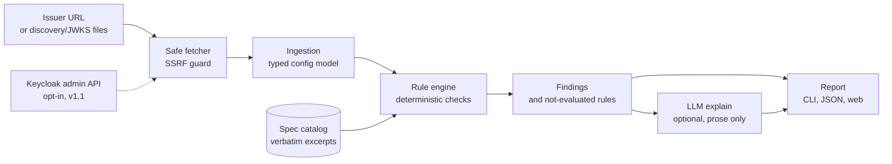

# sso-auditor

[](https://github.com/rbalukja15/sso-auditor/actions/workflows/ci.yml?query=branch%3Amain)
[](LICENSE)

**Audit any OpenID Connect provider's published configuration from the outside, with no
credentials, and get findings that quote the spec section they break.**

Live demo: _coming with [M6](https://github.com/rbalukja15/sso-auditor/milestone/7)_

> [!NOTE]
> sso-auditor is in early development and not installable yet. The
> [roadmap](#roadmap) shows what is being built.

sso-auditor is a **configuration auditor**, not a penetration-testing tool. Give it an
issuer URL and it reads the issuer's discovery document and signing keys, runs
deterministic checks against the OAuth 2.0 and OpenID Connect specs, and reports:

- **Findings**, each with a severity, the offending value and where it came from, and a
  verbatim excerpt of the spec section it breaks, linked to the source.
- **What it could not evaluate, and why**, so a short report never reads as a clean bill
  of health. Checks that need data the issuer doesn't publish say so instead of passing.
- **Optional plain-language explanations** for your configuration, written by an LLM
  that can only explain existing findings. It cannot add, remove or change them.

## Scope and non-goals

**In scope**

- Any OpenID Connect issuer: Keycloak, Google, Microsoft Entra ID, Auth0, Okta and others.
  Version 1.0 audits the discovery document (`/.well-known/openid-configuration`) and the
  JWKS, which every issuer publishes.
- Keycloak admin mode, planned for v1.1: an opt-in, local-only read of realm and client
  settings with a view-only service account.
- Checks grounded in public best practice: RFC 9700 (OAuth 2.0 Security Best Current
  Practice), OpenID Connect Core and Discovery, RFC 7517/7518 (JWK and JWA), RFC 8414,
  RFC 7636 (PKCE) and related specs.

**Read-only, always.** sso-auditor never attempts exploitation, never runs an OAuth flow,
never registers clients and never changes configuration. It makes a short, fixed list of
requests, recorded in
[ADR-0002](docs/adr/0002-data-sources-and-read-only-guarantees.md), and every one of them goes through a fetcher that
refuses private, loopback and cloud-metadata addresses.

**Non-goals** (from [ADR-0001](docs/adr/0001-stack-and-scope.md))

- **SAML.** Despite "SSO" in the name, only OpenID Connect and OAuth 2.0 are covered.
- **Relying-party token validation.** Whether your application checks `aud`, `iss` and
  signatures depends on your application's code, which an issuer audit can't see.
- **Other vendors' management APIs** (Okta, Auth0, Entra ID). Those providers get the
  discovery and JWKS checks.
- **Active testing.** No fuzzing, no authorization requests, no attempts to log in.

## How it compares

### Prior art

[kcwarden](https://pypi.org/project/kcwarden/) (by iteratec) already audits Keycloak
realm configuration: you export the realm with admin access and it checks the file
offline. sso-auditor takes a different angle:

- it audits **any OIDC issuer** from its public discovery document and JWKS, with **no
  credentials**;
- every finding carries a **verbatim spec excerpt** and a link to the section;
- it reports explicitly what was **not evaluated**;
- LLM explanations are **bound to the findings** and validated, so the model can't invent
  or alter them;
- detection quality will be **measured and published** (precision and recall over good and
  bad fixture configurations, see [docs/evaluation.md](docs/evaluation.md)).

The two tools are **complementary**, not competitors.

### When to use which

| You want to... | Use |
| --- | --- |
| Audit a Keycloak realm you administer, down to every client, role and flow | **kcwarden** |
| Check any OIDC provider (Google, Entra ID, Auth0, Okta, a vendor's Keycloak) without credentials | **sso-auditor** |
| See what an issuer exposes to the internet, the way a relying party or an attacker would | **sso-auditor** |
| Get each finding explained with the spec text behind it | **sso-auditor** |
| Run both on a Keycloak you operate: kcwarden for the inside view, sso-auditor for the outside view | **both** |

Active conformance testers such as the
[OpenID conformance suite](https://openid.net/certification/) answer a different
question: does an implementation follow the spec when you run real flows against it?
sso-auditor is passive and only reads what is published.

## Architecture



Components and boundaries are described in [docs/architecture.md](docs/architecture.md).
The stack and the scope invariants every change must keep are in
[ADR-0001](docs/adr/0001-stack-and-scope.md).

## Roadmap

v1.0 is discovery-only. It ships when M0 to M6 are done.

| Milestone | Goal |
| --- | --- |
| [M0: Project setup and documentation](https://github.com/rbalukja15/sso-auditor/milestone/1) | Scaffold, README, ADRs, CI, security policy |
| [M1: Discovery and config ingestion](https://github.com/rbalukja15/sso-auditor/milestone/2) | Safe fetcher, discovery and JWKS client, secret redaction |
| [M2: Rule engine](https://github.com/rbalukja15/sso-auditor/milestone/3) | Spec-cited checks and the first end-to-end CLI audit |
| [M3: Fixtures and evaluation](https://github.com/rbalukja15/sso-auditor/milestone/4) | Good and bad configurations, precision and recall |
| [M4: LLM explanations](https://github.com/rbalukja15/sso-auditor/milestone/5) | Explanations bound to findings, remediation plan, faithfulness eval |
| [M5: CLI and web report](https://github.com/rbalukja15/sso-auditor/milestone/6) | HTTP API, web report, abuse hardening for the demo |
| [M6: Deploy, demo and release](https://github.com/rbalukja15/sso-auditor/milestone/7) | Live demo, demo GIF, case study, v1.0.0 |

After v1.0: **Keycloak admin mode** (#8, #11, #12) adds realm and client checks from the
admin API with a view-only service account, local CLI only.

## Responsible use

- Audit only issuers you operate or are authorised to assess. sso-auditor reads public
  metadata, but an audit is still a security assessment of someone's system.
- Use admin mode (v1.1) only with a view-only service account the realm's owner created
  for it. The hosted demo never accepts credentials.
- The hosted demo logs the time, the audited host, the outcome and LLM token use, never
  fetched documents or LLM prompts. [SECURITY.md](SECURITY.md#responsible-use) has the
  full policy.

## Security

Report vulnerabilities privately through
[GitHub's vulnerability reporting](https://github.com/rbalukja15/sso-auditor/security/advisories/new);
see [SECURITY.md](SECURITY.md) for scope and what to expect. The
[threat model](docs/threat-model.md) lists the assets, the adversaries (malicious issuer
operators, demo abusers, prompt injectors, supply-chain attackers) and the issue that
mitigates each attack.

## Development

You need [uv](https://docs.astral.sh/uv/) and `make`.

```sh
make dev    # install the packages and dev tools, set up pre-commit
make lint   # ruff, format check, mypy --strict, zizmor workflow audit
make test   # pytest
```

## License

[Apache-2.0](LICENSE)
