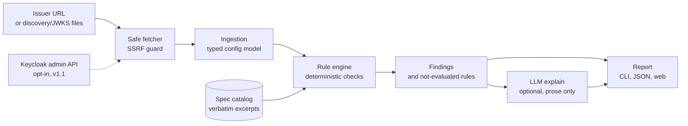

# Architecture

How sso-auditor turns an issuer URL into a report: the components, the data that flows between them, and where each boundary is enforced.

The README embeds the same diagram; change both together.

## Components

| Component | Package | Responsibility | Issue |
| --- | --- | --- | --- |
| Safe fetcher | `sso-auditor-core` | The only HTTP client. Validates every URL and every resolved address, connects to the validated IP, follows redirects one checked hop at a time, caps time and size. | #30 |
| Ingestion | `sso-auditor-core` | Fetches or loads the discovery document and JWKS and normalises them into a typed config model that records each field's provenance and source. | #7 |
| Admin client (v1.1) | `sso-auditor-core` | Opt-in, local-CLI-only read of Keycloak realm and client settings with a view-only service account. | #8 |
| Redaction | `sso-auditor-core` | Keeps secrets out of the config model, logs, reports and LLM prompts. | #31 |
| Rule engine | `sso-auditor-core` | Runs deterministic rules over the config model. Each rule cites a spec catalog entry; missing data yields `not_evaluated`, never a pass. | #10 |
| Explanations | `sso-auditor-core` | Optional LLM prose for existing findings, joined by `finding_id` and validated; the template text is the fallback. | #16 |
| CLI | `sso-auditor` | `sso-auditor <issuer-url>`, text and JSON output, exit codes for CI use. | #18 |
| HTTP API | `sso-auditor-api` | The hosted demo's backend: discovery-only, strict fetcher profile, rate and cost limits. | #33, #20 |
| Web report | `sso-auditor-api` (static files) | One page that renders the report as text nodes under a strict CSP. | #19 |

## Trust boundaries

- **Everything an issuer serves is untrusted**: URLs inside the discovery document, key
  material, string fields, response sizes and redirect targets. The fetcher and the
  config model treat it as data, and the web report renders it as text.
- **LLM output is untrusted** too. It can only attach prose to a known `finding_id`
  (ADR-0001, invariant I2).
- The [threat model](threat-model.md) maps each adversary to the issue that mitigates it.
